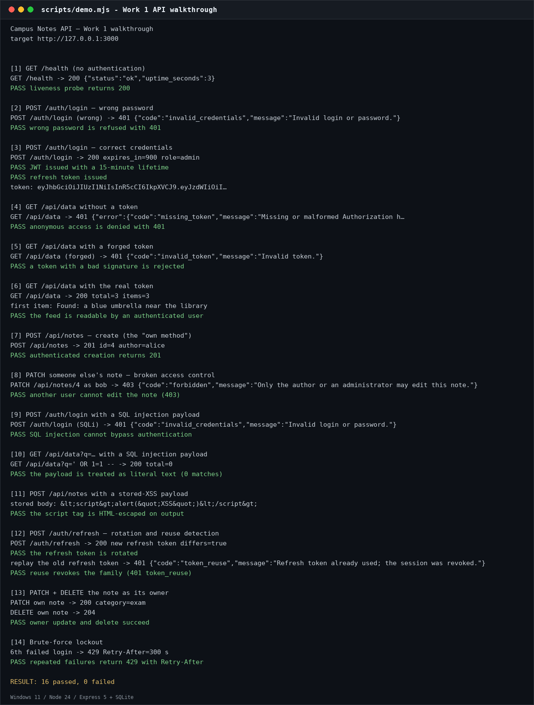
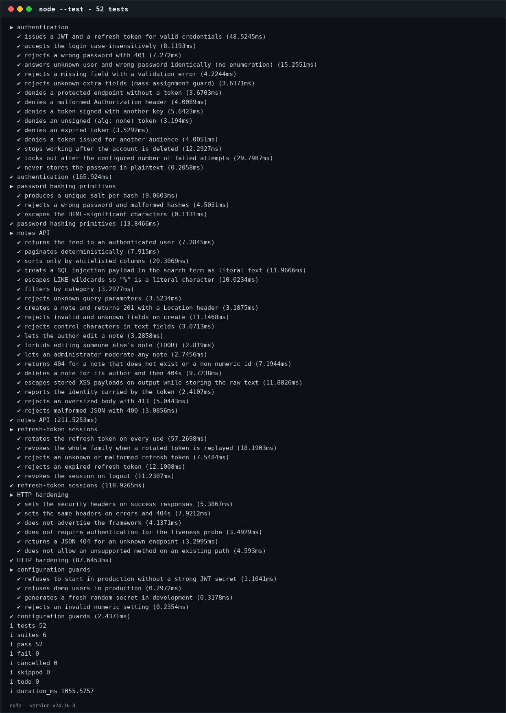
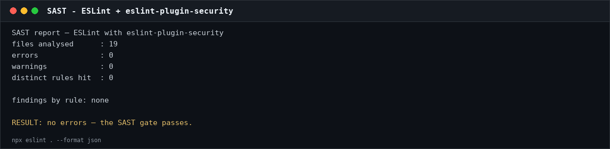
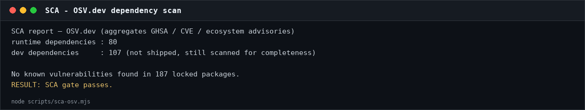
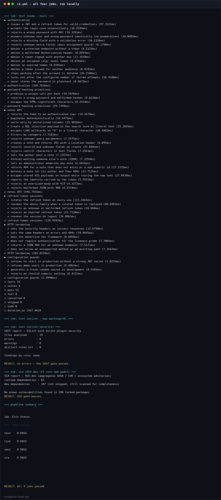
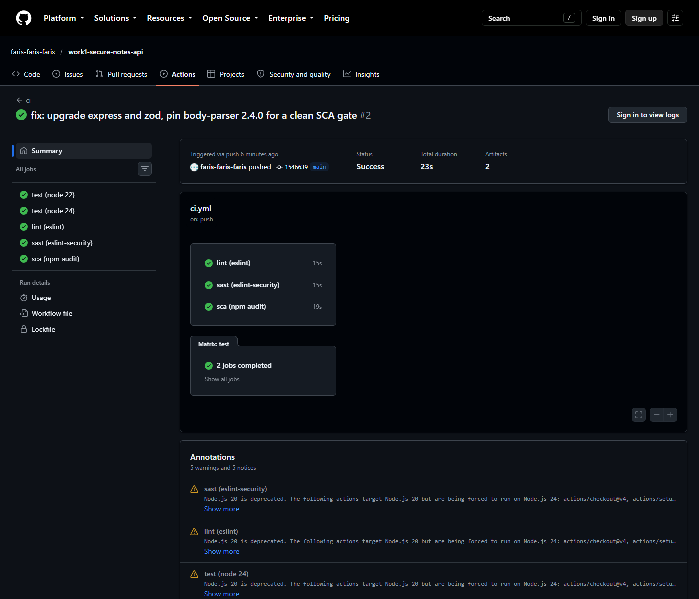
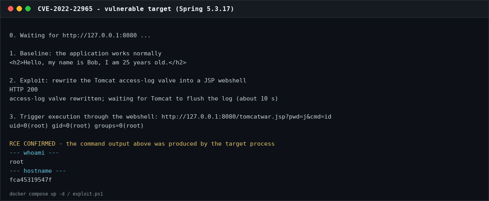
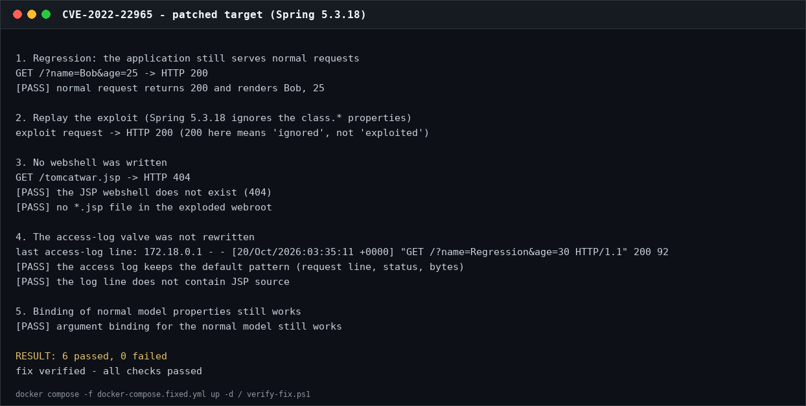

# Work 1 — Secure REST API, CI/CD and CVE-2022-22965

**Student:** Wu ZiYang · **HDU number:** 23320121 · **Variant:** — · **Date:** 2026-10-20

This repository is the Work 1 deliverable for the Information Security course:
a hardened campus-noticeboard REST API written in Node.js + Express, a CI
pipeline with SAST and SCA, and a complete study of **CVE-2022-22965
("Spring4Shell")** — reproduction, root-cause analysis, patch and verification.

* Full report: [`docs/report_en.pdf`](docs/report_en.pdf) ·
  [`docs/report_zh.pdf`](docs/report_zh.pdf)
* Repository: <https://github.com/faris-faris-faris/work1-secure-notes-api>
* CI pipeline (last successful run): <https://github.com/faris-faris-faris/work1-secure-notes-api/actions/runs/40104034585>
* All workflow runs: <https://github.com/faris-faris-faris/work1-secure-notes-api/actions>
* Vulnerable-environment study: [`cve/README.md`](cve/README.md)

| Item | Value |
|---|---|
| Runtime | Node.js 22+ (CI matrix: 22 and 24), Express 5.3 |
| Database | SQLite through the built-in `node:sqlite` module |
| Authentication | scrypt password hashing + HS256 JWT + rotating refresh tokens |
| Validation | Zod 4.6, strict schemas |
| Tests | 52 `node:test` cases through `supertest` |
| SAST | ESLint 9 + `eslint-plugin-security` |
| SCA | `npm audit` in CI; OSV.dev through `scripts/sca-osv.mjs` |
| CVE | **CVE-2022-22965**, Spring MVC data-binding RCE (CVSS 3.1 **9.8**) |

---

## 1. Quick start

```bash
npm install
npm start                     # http://127.0.0.1:3000
npm test                      # 52 tests
```

```powershell
# 16 end-to-end checks: login, 401, SQLi, XSS, IDOR, refresh replay, lockout
powershell -ExecutionPolicy Bypass -File .\scripts\run-demo.ps1

# the four ci.yml jobs, executed locally
powershell -ExecutionPolicy Bypass -File .\scripts\ci-local.ps1
```

Demo accounts (one-off lab data): `alice / Passw0rd!Alice` (administrator) and
`bob / Passw0rd!Bob`.

## 2. API

| Method | Path | Auth | Purpose |
|---|---|---|---|
| POST | `/auth/login` | — | Accepts `login` and `password`; returns an access token and a refresh token |
| GET | `/api/data` | Bearer | Note feed (`limit`, `offset`, `q`, `category`, `sort`) |
| POST | `/api/notes` | Bearer | **Own method** — create a note |
| GET / PATCH / DELETE | `/api/notes/:id` | Bearer | Read / edit / delete (author or administrator only) |
| POST | `/auth/refresh` | — | Rotate the refresh token |
| POST | `/auth/logout` | — | Revoke the refresh token |
| GET | `/api/me` | Bearer | Current identity and token metadata |
| GET | `/health` | — | Liveness probe |

```bash
curl -s -X POST http://127.0.0.1:3000/auth/login \
     -H 'Content-Type: application/json' \
     -d '{"login":"alice","password":"Passw0rd!Alice"}'
```

```json
{
  "access_token": "eyJhbGciOiJIUzI1NiIsInR5cCI6IkpXVCJ9...",
  "token_type": "Bearer",
  "expires_in": 900,
  "refresh_token": "8Kx...",
  "user": {"id": 1, "login": "alice", "display_name": "Alice (course admin)", "role": "admin"}
}
```

Without a token:

```http
HTTP/1.1 401 Unauthorized
WWW-Authenticate: Bearer error="missing_token"
Content-Type: application/json; charset=utf-8

{"error":{"code":"missing_token","message":"Missing or malformed Authorization header (expected \"Bearer <token>\")."}}
```



*Figure 1 — the 16-check walkthrough (`scripts/demo.mjs`).*

## 3. Security measures

### 3.1 SQL injection

Every value that carries user data is a **bound parameter**; `src/db.js` is the
only module that contains SQL, so the rule is reviewable in one place.

```js
const user = db.prepare('SELECT * FROM users WHERE login = ? COLLATE NOCASE').get(login);
```

Two things SQL cannot parameterise are handled explicitly:

* **`LIKE` wildcards** — `%` and `_` in the *value* are escaped and the
  statement declares `ESCAPE '\'`, so searching for `100%` is literal.
* **`ORDER BY`** — the sort key comes from the client but never reaches SQL
  text: it is looked up in a frozen allow-list, and validation rejects anything
  outside the enum before the repository is called.

Tests send `' OR 1=1 --`, `' UNION SELECT * FROM users --` and
`'; DROP TABLE notes; --` to the search endpoint: every one returns `total=0`,
and the `notes` table still has its rows. The login endpoint refuses the
tautology with `401`.

### 3.2 Cross-site scripting

The database stores text verbatim and the API encodes it **on output** — the
OWASP XSS Prevention Cheat Sheet rule:

```js
const HTML_ESCAPES = { '&': '&amp;', '<': '&lt;', '>': '&gt;', '"': '&quot;', "'": '&#39;', '`': '&#96;' };
export const escapeHtml = (value) => String(value).replace(/[&<>"'`]/g, (c) => HTML_ESCAPES[c]);
```

Every user-controlled field of a note (`title`, `body`, author login and
display name) passes through `escapeHtml` in `presentNote()`. Defence in depth:

* `Content-Type: application/json` and `X-Content-Type-Options: nosniff`;
* `Content-Security-Policy: default-src 'none'; frame-ancestors 'none'`;
* validation rejects control characters and caps field lengths (`title` 120,
  `body` 4000);
* unknown JSON fields are rejected (`.strict()`), so `author_id` or `role`
  cannot be smuggled into a create request.

The XSS tests store `<script>`, ``, `<svg onload>`, `javascript:`
and `<iframe>` payloads, assert that no raw form appears in any response, and
check directly against SQLite that the original text is still stored.

### 3.3 Authentication and access control

| Requirement | Implementation |
|---|---|
| Never store plaintext | scrypt, N=2¹⁵, r=8, p=1, 16-byte salt; parameters stored with the hash |
| Constant-time check | `crypto.timingSafeEqual` on the derived keys |
| Issue a JWT | HS256 with `sub`, `iss`, `aud`, `iat`, `nbf`, `exp`, `jti`; 15-minute TTL |
| Verify on every protected endpoint | signature, algorithm, issuer, audience, expiry, `sub` |
| Algorithm pinning | `algorithms: ['HS256']` — defeats `alg: none` and RS→HS confusion |
| Revocation | the user is re-read from the database on every request |
| No enumeration | the same 401 body for unknown user and wrong password, plus a dummy scrypt run |
| Brute force | 5 failures per (IP, login) per 5 minutes → `429` with `Retry-After` |
| Refresh tokens | 256-bit opaque token, SHA-256 at rest, rotated on every use; replay revokes the family |
| Object-level access | PATCH/DELETE require the author or an administrator (IDOR test included) |



*Figure 2 — the full test suite: 52 passed, 0 failed.*

## 4. CI/CD: SAST and SCA

`.github/workflows/ci.yml` runs four jobs on every push and pull request:

| Job | Tool | Gate |
|---|---|---|
| `test` | `node --test` with coverage (Node 22 and 24) | any failing test |
| `lint` | ESLint | any error or warning (`--max-warnings=0`) |
| `sast` | ESLint + `eslint-plugin-security` | any security rule hit |
| `sca` | `npm audit` | any high or critical vulnerability |



*Figure 3 — SAST: 19 files analysed, 0 errors, 0 warnings, no security rule hit.*



*Figure 4 — SCA: no known vulnerabilities in 187 locked packages.*





*Figure 5 — top: all four `ci.yml` jobs executed locally with
`scripts/ci-local.ps1`. Bottom: the same workflow green on GitHub Actions —
run [40104034585](https://github.com/faris-faris-faris/work1-secure-notes-api/actions/runs/40104034585)
on commit `b0c8e9b` passed `test` (Node 22 and 24), `lint`, `sast` and `sca`.
The raw run data is in [`docs/evidence/github-actions-run.txt`](docs/evidence/github-actions-run.txt).*

## 5. CVE-2022-22965 — Spring4Shell

| Property | Value |
|---|---|
| CVE | **CVE-2022-22965** ("Spring4Shell") |
| Component | Spring Framework MVC data binding, WAR deployment on Tomcat, JDK 9+ |
| Class | CWE-94 — Improper Control of Generation of Code |
| CVSS 3.1 | **9.8 Critical** — `AV:N/AC:L/PR:N/UI:N/S:U/C:H/I:H/A:H` |
| Affected | Spring 5.3.0–5.3.17, 5.2.0–5.2.19 |
| Fixed in | Spring 5.3.18 / 5.2.20 (2022-03-31) |
| Vulhub path | `vulhub/spring/CVE-2022-22965` |

### 5.1 Reproduction

```bash
cd cve
docker compose up -d            # vulnerable: Spring 5.3.17, Tomcat 8.5.77, JDK 11
curl -s 'http://127.0.0.1:8080/?name=Bob&age=25'
# <h2>Hello, my name is Bob, I am 25 years old.</h2>

powershell -ExecutionPolicy Bypass -File .\exploit.ps1
```

The exploit binds a chain of ordinary JavaBeans getters through a request
parameter — `class.module.classLoader.resources.context.parent.pipeline.first` —
and rewrites Tomcat's `AccessLogValve` so that the access log becomes a JSP
webshell under the webroot. It then requests `/tomcatwar.jsp?pwd=j&cmd=id`:

```
GET /tomcatwar.jsp?pwd=j&cmd=id
uid=0(root) gid=0(root) groups=0(root)
```



*Figure 6 — the vulnerable target: a JSP webshell written through the log valve,
then `id` executed by the target process.*

### 5.2 Root cause

Spring MVC binds request parameters to a handler's model attribute. Before
5.3.18, `CachedIntrospectionResults` exposed the JavaBeans `class` property to
that binder. From `Class` the attacker reaches `module`, the module's
classloader, Tomcat's web resources, the context, the host, its pipeline and the
first valve. Each step is an ordinary getter; nothing in the chain checks that
the *request* should be allowed to set those objects. The defect is therefore a
capability that data binding should never have had, not a missing check in one
application. The WAR deployment on Tomcat and JDK 9+ are prerequisites: the
chain needs `module` (JDK 9+) and a `WebappClassLoaderBase` with a writable
access-log valve.

### 5.3 Fix

The fix is the framework upgrade, implemented in `cve/Dockerfile.fixed` and
`cve/docker-compose.fixed.yml`:

```yaml
# docker-compose.fixed.yml
services:
  spring:
    build:
      context: .
      dockerfile: Dockerfile.fixed   # Spring 5.3.18 jars, same application
```

Spring 5.3.18 blocks the `class` property on the binder. For applications that
cannot upgrade, an `@InitBinder` that calls
`setDisallowedFields("class.*", "Class.*", "*.class.*", "*.Class.*")` restores
the same default-deny behaviour; binding to explicit DTOs instead of a generic
model attribute is the structural fix.

### 5.4 Proof that the attack no longer works

```bash
docker compose down
docker compose -f docker-compose.fixed.yml up -d --build
powershell -ExecutionPolicy Bypass -File .\verify-fix.ps1
```



*Figure 7 — the patched target: the exploit request is ignored, no JSP is
written, the access-log format is unchanged, normal binding still works.
6 checks passed.*

The verification is behavioural on purpose: the patched server answers `200`,
not `4xx`, so the test asserts the absence of the webshell and of the valve
rewrite, plus a regression request (`/?name=Bob&age=25`) that must still render.

## 6. Layout

```
src/            application (app, config, db, security, validation, routes)
tests/          52 tests
scripts/        demo, ci-local, sast-summary, sca-osv, render_png, build_report
cve/            vulnerable environment, exploit, patch, verification
docs/           EN/ZH reports (md/html/pdf), evidence transcripts, screenshots
.github/        ci.yml (test / lint / sast / sca)
```

Every screenshot has a provenance entry in
[`docs/screenshots/README.md`](docs/screenshots/README.md); the raw stdout is in
[`docs/evidence/`](docs/evidence/).

## 7. Submission links

| Item | Link |
|---|---|
| Public repository | <https://github.com/faris-faris-faris/work1-secure-notes-api> |
| Last successful pipeline run | <https://github.com/faris-faris-faris/work1-secure-notes-api/actions/runs/40104034585> |
| Reports (EN + ZH) | [`docs/report_en.pdf`](docs/report_en.pdf), [`docs/report_zh.pdf`](docs/report_zh.pdf) |
| Folder with the fixes | [`cve/`](cve/) |
| Evidence transcripts | [`docs/evidence/`](docs/evidence/) |

## 8. References

* OWASP Top 10 — <https://owasp.org/www-project-top-ten/>
* OWASP Cheat Sheet Series — <https://cheatsheetseries.owasp.org/>
* Vulhub `spring/CVE-2022-22965` — <https://github.com/vulhub/vulhub/tree/master/spring/CVE-2022-22965>
* NVD — <https://nvd.nist.gov/vuln/detail/CVE-2022-22965>
* Spring Framework 5.3.18 release notes — <https://github.com/spring-projects/spring-framework/releases/tag/v5.3.18>

> Demo accounts and keys are for a one-off lab environment only and must not be
> reused outside it.
